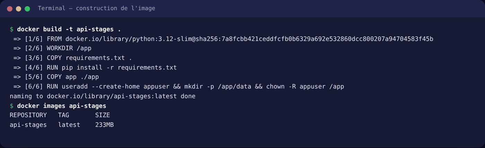
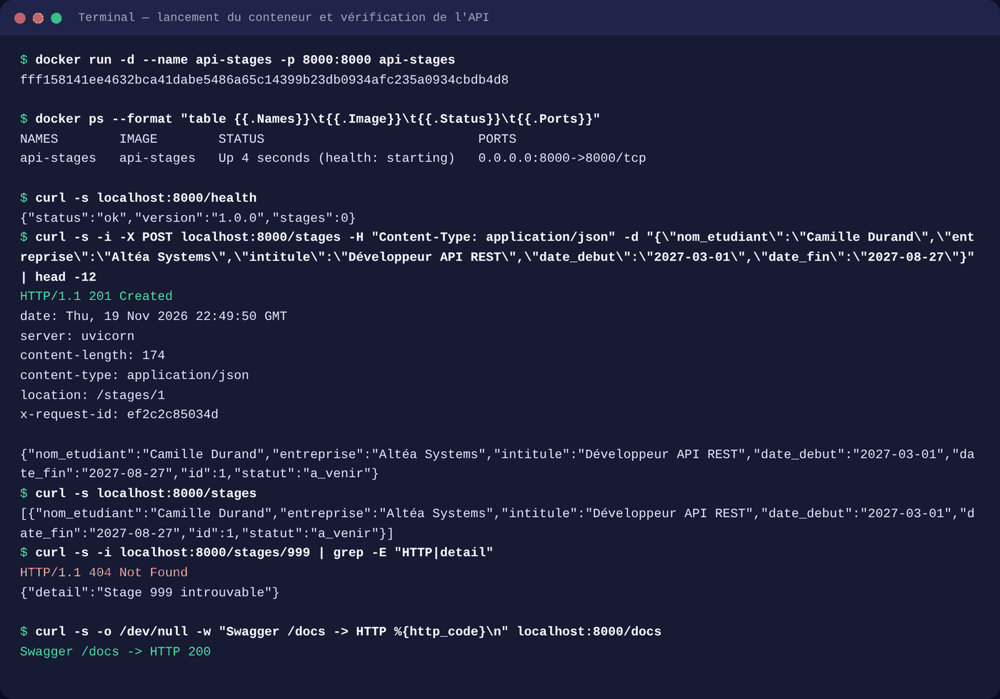
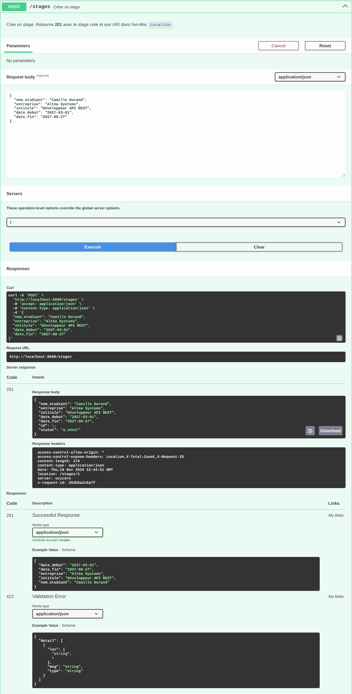
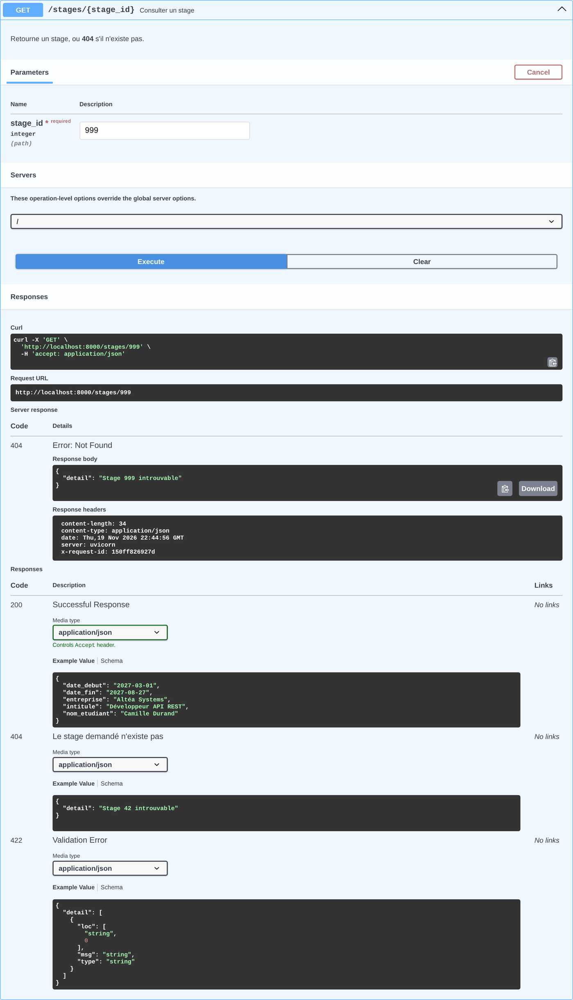

# Suivi des stages — API REST dans le Cloud

Mini-projet *Cloud Computing, Microservices & API* : une **API REST** (Python / FastAPI / SQLite) pour gérer les stages des étudiants d'une école d'ingénieurs, **conteneurisée avec Docker** et **déployée sur Render**. Une interface web simple, servie par la même application, permet de l'utiliser sans outil technique.

| | |
|---|---|
| 🌍 **URL publique de l'API** | `https://VOTRE-SERVICE.onrender.com` *(à remplacer après le déploiement)* |
| 📘 **Documentation Swagger** | `https://VOTRE-SERVICE.onrender.com/docs` |
| 💻 **Dépôt GitHub** | `https://github.com/VOTRE-COMPTE/gestion-stages` |

> ⚠️ Projet pédagogique : n'utilisez **aucune donnée personnelle réelle**. Sur l'offre gratuite de Render, le service se met en veille (le premier appel peut prendre ~1 minute) et la base SQLite peut être réinitialisée à chaque redémarrage ou redéploiement.


## Sommaire
1. [Fonctionnalités](#fonctionnalités)
2. [Endpoints de l'API](#endpoints-de-lapi)
3. [Lancer en local](#lancer-en-local)
4. [Docker](#docker)
5. [Déploiement sur Render](#déploiement-sur-render)
6. [Tester l'API](#tester-lapi)
7. [Architecture et notions du cours](#architecture-et-notions-du-cours)
8. [Structure du projet](#structure-du-projet)

## Fonctionnalités

- **API REST complète** : créer, lister, consulter, modifier, supprimer un stage ; erreurs JSON claires (`404` si le stage n'existe pas, `422` si les données sont invalides).
- **Interface web** : tableau de bord (stages en cours / à venir / terminés), recherche, filtres, tri, progression de chaque stage, formulaire avec validation et durées rapides.
- **Visite guidée à la première connexion** (relançable avec le bouton « ? »).
- Onglet **API & Cloud** : adresse de base, liens Swagger / ReDoc / OpenAPI, commandes `curl` à copier, schéma d'architecture.
- Thème clair / sombre, responsive (mobile), accessible au clavier.
- Un stage = `id`, `nom_etudiant`, `entreprise`, `intitule`, `date_debut`, `date_fin` (+ `statut` calculé : `a_venir`, `en_cours`, `termine`).

## Endpoints de l'API

| Méthode | URI | Description | Codes |
|---|---|---|---|
| `POST` | `/stages` | Créer un stage (en-tête `Location` renvoyé) | 201, 422 |
| `GET` | `/stages` | Lister les stages. Paramètres : `q`, `statut`, `entreprise`, `tri` (ex. `-date_debut`), `limit`, `offset`. Total dans `X-Total-Count` | 200 |
| `GET` | `/stages/{id}` | Consulter un stage | 200, 404 |
| `PUT` | `/stages/{id}` | Modifier un stage (remplace tous les champs) | 200, 404, 422 |
| `DELETE` | `/stages/{id}` | Supprimer un stage | 204, 404 |
| `GET` | `/health` | Santé du service (supervision) | 200 |
| `GET` | `/api` | Point d'entrée avec liens (HATEOAS) | 200 |
| `GET` | `/docs`, `/redoc`, `/openapi.json` | Documentation OpenAPI générée automatiquement | 200 |

**Exemple de stage (JSON)**

```json
{
  "id": 1,
  "nom_etudiant": "Camille Durand",
  "entreprise": "Altéa Systems",
  "intitule": "Développeur API REST",
  "date_debut": "2027-03-01",
  "date_fin": "2027-08-27",
  "statut": "a_venir"
}
```

**Exemples `curl`** (remplacez l'adresse par votre URL Render)

```bash
curl -X POST http://localhost:8000/stages -H "Content-Type: application/json" \
  -d '{"nom_etudiant":"Camille Durand","entreprise":"Altéa Systems","intitule":"Développeur API REST","date_debut":"2027-03-01","date_fin":"2027-08-27"}'
curl http://localhost:8000/stages
curl "http://localhost:8000/stages?statut=en_cours&q=altéa"
curl http://localhost:8000/stages/1
curl -X PUT http://localhost:8000/stages/1 -H "Content-Type: application/json" \
  -d '{"nom_etudiant":"Camille Durand","entreprise":"Altéa Systems","intitule":"Ingénieur DevOps","date_debut":"2027-03-01","date_fin":"2027-08-27"}'
curl -X DELETE http://localhost:8000/stages/1
curl http://localhost:8000/stages/999        # → 404 {"detail":"Stage 999 introuvable"}
```

## Lancer en local

```bash
python -m venv .venv && source .venv/bin/activate      # Windows : .venv\Scripts\activate
pip install -r requirements-dev.txt
uvicorn app.main:app --reload                          # http://localhost:8000
pytest -q                                              # 14 tests
```

## Docker

```bash
docker build -t api-stages .                 # 1. construire l'image
docker run -d --name api-stages -p 8000:8000 api-stages   # 2. lancer un conteneur
curl localhost:8000/health                   # 3. vérifier que l'API répond
# 4. documentation Swagger : http://localhost:8000/docs
docker logs api-stages                       # journaux des requêtes
docker rm -f api-stages                      # arrêter et supprimer
```

Le [`Dockerfile`](Dockerfile) part de `python:3.12-slim`, installe les dépendances (couche mise en cache), copie le code, s'exécute **sans droits root** et lit le port dans la variable `PORT` (fournie par Render, `8000` par défaut). Un `HEALTHCHECK` surveille `/health`.

| Build | Lancement et vérification |
|---|---|
|  |  |

## Déploiement sur Render

1. **Déposer le code sur GitHub** (voir ci-dessous) : le dépôt doit contenir le `Dockerfile` à la racine.
2. Créer un compte sur <https://render.com> (connexion possible avec GitHub).
3. **New + → Web Service**, puis **connecter le dépôt GitHub**.
4. Renseigner : *Language / Runtime* = **Docker**, *Instance type* = **Free**. Laisser les autres champs par défaut (Render détecte le `Dockerfile`).
5. **Create Web Service** : Render construit l'image puis démarre le conteneur (quelques minutes).
6. Récupérer l'**URL publique** affichée en haut de la page du service (`https://….onrender.com`).
7. Tester depuis un navigateur ou Postman : `/` (interface), `/docs` (Swagger), `/stages`.

Option : `render.yaml` (Blueprint) décrit le même service (`New + → Blueprint`). **Health check** : `/health`. Chaque `git push` sur `main` redéploie automatiquement.

### Déposer le code sur GitHub

```bash
git init -b main
git add .
git commit -m "API REST de gestion des stages"
git remote add origin https://github.com/VOTRE-COMPTE/gestion-stages.git
git push -u origin main
```

Sans ligne de commande : créer un dépôt vide sur github.com, puis **Add file → Upload files** et glisser le contenu du dossier.

## Tester l'API

- **Swagger** (`/docs`) : déplier un endpoint → *Try it out* → *Execute*.
- **Postman** : *Import → Link* avec `https://VOTRE-SERVICE.onrender.com/openapi.json` crée toute la collection.
- **Interface web** : onglet *Stages*.

Scénario vérifié : création (201) → liste (200) → consultation (200) → modification (200) → suppression (204) → stage inexistant (404) → données invalides (422).

| Création 201 | Stage inexistant 404 |
|---|---|
|  |  |

Autres captures dans [`docs/screenshots`](docs/screenshots) : liste (23), consultation (24), modification (25), suppression (27), dates incohérentes (22), interface web (01 à 14), conteneur Docker (30 à 34).

## Architecture et notions du cours

```
Navigateur / Postman ──HTTPS·JSON──▶ Render (PaaS, cloud public)
                                       └─ Conteneur Docker
                                            └─ FastAPI ──▶ SQLite (stages.db)
GitHub ──push──▶ CI (tests + build) ──▶ redéploiement automatique
```

| Notion du cours | Mise en œuvre |
|---|---|
| Cloud public, **PaaS** | Render héberge l'application, sans serveur à administrer |
| **Conteneur Docker** | Dockerfile → image → conteneur, identique en local et dans le cloud |
| **API REST** | une URI par ressource (`/stages/{id}`), CRUD via GET/POST/PUT/DELETE, JSON, codes HTTP |
| **OpenAPI / Swagger** | documentation générée automatiquement (`/docs`) |
| Web service, **API gateway** (évoqués) | une seule ressource ici ; le schéma reste extensible en microservices |
| Sécurité : authentification, autorisation, **traçabilité** | journal de chaque requête (méthode, statut, durée, `X-Request-ID`), requêtes SQL paramétrées, validation des entrées, conteneur non-root. L'authentification (JWT / OAuth2) est volontairement hors périmètre |
| **DevOps / CI-CD** | GitHub Actions ([`ci.yml`](.github/workflows/ci.yml)) : tests + build Docker ; Render redéploie à chaque push |
| Supervision | `/health`, `HEALTHCHECK` Docker, logs |
| Limites du cloud | veille du plan gratuit, disque éphémère (SQLite perdue au redéploiement), dépendance au fournisseur |

## Structure du projet

```
app/main.py        routes REST, journalisation, CORS, statut calculé
app/schemas.py     validation Pydantic (dates cohérentes, champs non vides)
app/database.py    SQLite (chemin via DATABASE_PATH)
app/static/        interface web (HTML, CSS, JS natifs, sans build)
tests/             14 tests pytest (CRUD, 404, 422, filtres, concurrence)
Dockerfile · render.yaml · .github/workflows/ci.yml
docs/screenshots/  captures d'écran
```
