<p align="center"></p>

# ISIS · Suivi des stages — API REST dans le Cloud

Mini-projet *Cloud Computing, Microservices & API* pour l'**école d'ingénieurs ISIS** : une **API REST** (Python / FastAPI / SQLite) qui gère les stages des étudiants, **conteneurisée avec Docker** et **déployée sur Render**. Une interface web, servie par la même application, permet de l'utiliser sans outil technique : tableau de bord, alertes, fiche détaillée, planning, statistiques, export Excel.

| | |
|---|---|
| 🌍 **Application et API en ligne** | <https://gestion-stages-r64g.onrender.com> |
| 📘 **Documentation Swagger** | <https://gestion-stages-r64g.onrender.com/docs> |
| 💻 **Dépôt GitHub** | <https://github.com/RomaneCano/gestion-stages> |

> ⚠️ Projet pédagogique : n'utilisez **aucune donnée personnelle réelle**. Sur l'offre gratuite de Render, le service se met en veille (le premier appel peut prendre ~1 minute) et la base SQLite peut être réinitialisée à chaque redémarrage ou redéploiement. Le bouton « Charger des exemples » repart d'un jeu de données fictives.

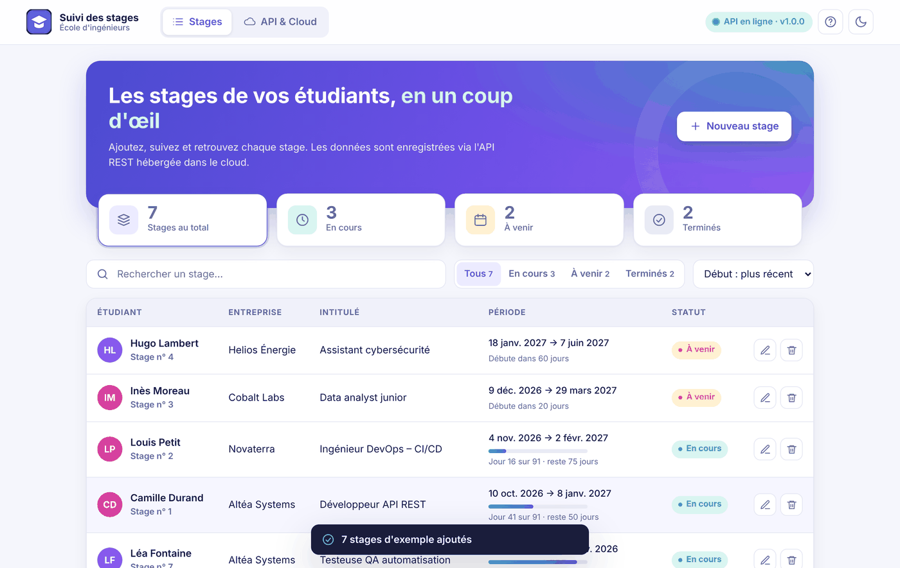

## Sommaire
1. [Fonctionnalités](#fonctionnalités)
2. [Endpoints de l'API](#endpoints-de-lapi)
3. [Lancer en local](#lancer-en-local)
4. [Docker](#docker)
5. [Déploiement sur Render](#déploiement-sur-render)
6. [Tester l'API](#tester-lapi)
7. [Architecture et notions du cours](#architecture-et-notions-du-cours)
8. [Structure du projet](#structure-du-projet)
9. [Galerie de captures](#galerie-de-captures)

## Fonctionnalités

**Ce que demande l'énoncé**
- API REST complète : créer, lister, consulter, modifier, supprimer un stage ; erreurs JSON claires (`404` si le stage n'existe pas, `422` si les données sont invalides).
- Un stage : `id`, `nom_etudiant`, `entreprise`, `intitule`, `date_debut`, `date_fin`.

**Pour aller plus loin**
- **Suivi enrichi** (champs facultatifs) : filière, ville, tuteur à l'école, maître de stage, convention signée, rapport remis, note finale sur 20, commentaire.
- **Alertes « À surveiller »** calculées par l'API : convention non signée, stage qui démarre ou se termine bientôt, rapport non remis, note à saisir (urgent / info).
- **Fiche détaillée** d'un stage : progression, contacts, cases à cocher (modification partielle via `PATCH`), note finale en jauge, appel API correspondant.
- **Planning** : frise chronologique (type Gantt) avec la ligne « Aujourd'hui ».
- **Statistiques** : durée moyenne, taux de conventions et de rapports, note moyenne, activité mois par mois, entreprises, filières, villes, distribution des notes.
- **Export CSV** (ouvrable dans Excel) de la sélection affichée, protégé contre l'injection de formules.
- **Recherche** (nom, entreprise, ville, filière…), filtres par statut, filière et entreprise, tri, raccourcis clavier (`/` pour chercher, `n` pour créer).
- **Visite guidée** à la première connexion (relançable avec le bouton « ? »), thème clair / sombre, affichage mobile, accessibilité clavier.
- **Onglet API & Cloud** : adresse de base, liens Swagger / ReDoc / OpenAPI, commandes `curl` à copier, schéma d'architecture, notions du cours.
- **Migration automatique** de la base SQLite (ajout des nouvelles colonnes sans perdre les données existantes).

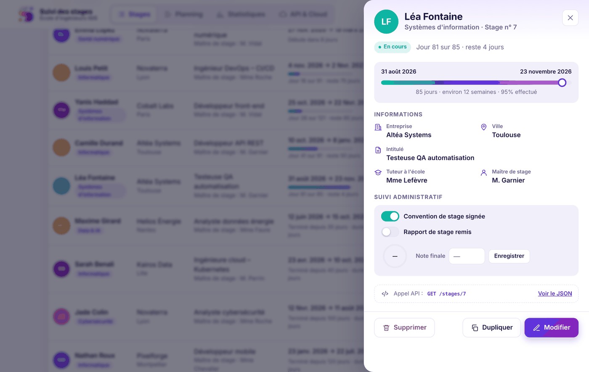

## Endpoints de l'API

| Méthode | URI | Description | Codes |
|---|---|---|---|
| `POST` | `/stages` | Créer un stage (en-tête `Location` renvoyé) | 201, 422 |
| `GET` | `/stages` | Lister. Filtres : `q`, `statut`, `entreprise`, `filiere`, `ville`, `convention_signee`, `rapport_remis` ; `tri` (ex. `-date_debut`), `limit`, `offset`. Total dans `X-Total-Count` | 200 |
| `GET` | `/stages/{id}` | Consulter un stage | 200, 404 |
| `PUT` | `/stages/{id}` | Remplacer toutes les données d'un stage | 200, 404, 422 |
| `PATCH` | `/stages/{id}` | Modifier seulement certains champs | 200, 404, 422 |
| `DELETE` | `/stages/{id}` | Supprimer un stage | 204, 404 |
| `GET` | `/stages/export.csv` | Export CSV (mêmes filtres que la liste) | 200 |
| `GET` | `/stats` | Indicateurs et statistiques | 200 |
| `GET` | `/alertes` | Actions à mener, priorisées | 200 |
| `GET` | `/health` | Santé du service (supervision) | 200 |
| `GET` | `/api` | Point d'entrée avec liens (HATEOAS) | 200 |
| `GET` | `/docs`, `/redoc`, `/openapi.json` | Documentation OpenAPI générée automatiquement | 200 |

Seuls `nom_etudiant`, `entreprise`, `intitule`, `date_debut` et `date_fin` sont obligatoires. Le champ `statut` (`a_venir`, `en_cours`, `termine`), `duree_jours` et `avancement` sont calculés par l'API.

**Exemple de stage (JSON)**

```json
{
  "id": 1,
  "nom_etudiant": "Camille Durand",
  "entreprise": "Altéa Systems",
  "intitule": "Développeur API REST",
  "date_debut": "2027-03-01",
  "date_fin": "2027-08-27",
  "filiere": "Informatique",
  "ville": "Toulouse",
  "tuteur_ecole": "Mme Lefèvre",
  "maitre_stage": "M. Garnier",
  "convention_signee": true,
  "rapport_remis": false,
  "note": null,
  "commentaire": "Mission autour d'une API de facturation.",
  "statut": "a_venir",
  "duree_jours": 180,
  "avancement": 0
}
```

**Exemples `curl`** (remplacez `http://localhost:8000` par l'URL Render)

```bash
curl -X POST http://localhost:8000/stages -H "Content-Type: application/json" \
  -d '{"nom_etudiant":"Camille Durand","entreprise":"Altéa Systems","intitule":"Développeur API REST","date_debut":"2027-03-01","date_fin":"2027-08-27","ville":"Toulouse"}'
curl http://localhost:8000/stages
curl "http://localhost:8000/stages?statut=en_cours&q=altéa&tri=date_fin"
curl http://localhost:8000/stages/1
curl -X PATCH http://localhost:8000/stages/1 -H "Content-Type: application/json" -d '{"convention_signee":true,"note":16}'
curl -X DELETE http://localhost:8000/stages/1
curl http://localhost:8000/stages/999        # → 404 {"detail":"Stage 999 introuvable"}
curl http://localhost:8000/stats
curl http://localhost:8000/alertes
curl -O -J http://localhost:8000/stages/export.csv
```

## Lancer en local

```bash
python -m venv .venv && source .venv/bin/activate      # Windows : .venv\Scripts\activate
pip install -r requirements-dev.txt
uvicorn app.main:app --reload                          # http://localhost:8000
pytest -q                                              # 22 tests
```

## Docker

```bash
docker build -t api-stages .                 # 1. construire l'image
docker run -d --name api-stages -p 8000:8000 api-stages   # 2. lancer un conteneur
curl localhost:8000/health                   # 3. vérifier que l'API répond
# 4. documentation Swagger : http://localhost:8000/docs
docker logs api-stages                       # journaux des requêtes
docker rm -f api-stages                      # arrêter et supprimer
```

Le [`Dockerfile`](Dockerfile) part de `python:3.12-slim`, installe les dépendances (couche mise en cache), copie le code, s'exécute **sans droits root** et lit le port dans la variable `PORT` (fournie par Render, `8000` par défaut). Un `HEALTHCHECK` surveille `/health`.

| Build | Lancement et vérification |
|---|---|
| 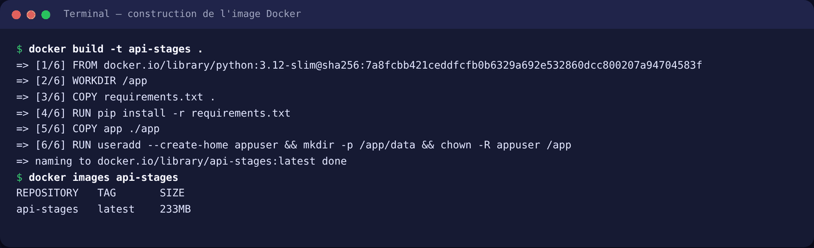 | 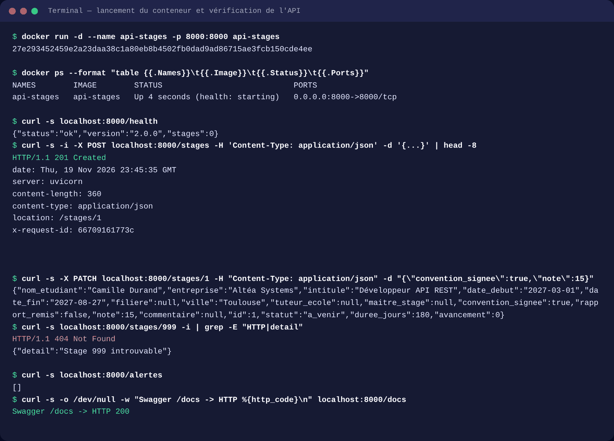 |

## Déploiement sur Render

Le service est déployé : <https://gestion-stages-r64g.onrender.com>.

1. **Déposer le code sur GitHub** : le dépôt contient le `Dockerfile` à la racine.
2. Créer un compte sur <https://render.com> (connexion avec GitHub).
3. **New + → Web Service**, puis connecter le dépôt `gestion-stages`.
4. *Language* = **Docker**, *Instance type* = **Free**, branche `main`.
5. **Create Web Service** : Render construit l'image puis démarre le conteneur.
6. Récupérer l'**URL publique** en haut de la page du service.
7. Tester depuis un navigateur ou Postman : `/` (interface), `/docs` (Swagger), `/stages`.

Option : `render.yaml` (Blueprint) décrit le même service. **Health check** : `/health`. Chaque `git push` sur `main` déclenche l'intégration continue (GitHub Actions) et un redéploiement automatique sur Render.

## Tester l'API

- **Swagger** (`/docs`) : déplier un endpoint → *Try it out* → *Execute*.
- **Postman** : *Import → Link* avec `https://gestion-stages-r64g.onrender.com/openapi.json` crée toute la collection.
- **Interface web** : onglets *Stages*, *Planning*, *Statistiques*.

Scénario vérifié : création (201) → liste (200) → consultation (200) → remplacement (200) → modification partielle (200) → suppression (204) → stage inexistant (404) → données invalides (422).

| Création 201 | Stage inexistant 404 |
|---|---|
| 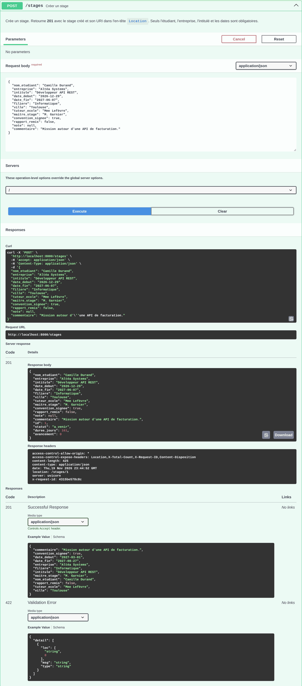 | 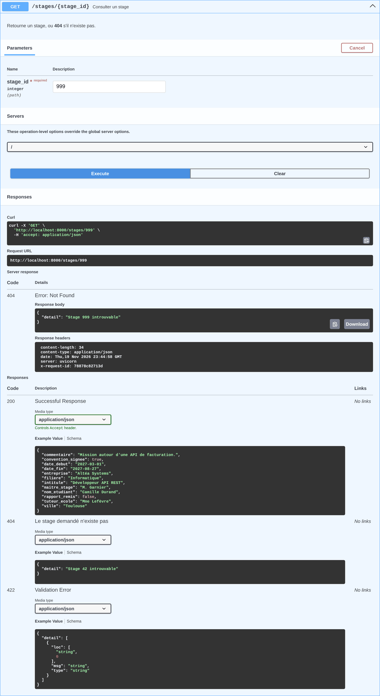 |

## Architecture et notions du cours

```
Navigateur / Postman ──HTTPS·JSON──▶ Render (PaaS, cloud public)
                                       └─ Conteneur Docker
                                            └─ FastAPI ──▶ SQLite (stages.db)
GitHub ──push──▶ CI (tests + build) ──▶ redéploiement automatique
```

| Notion du cours | Mise en œuvre |
|---|---|
| Cloud public, **PaaS** | Render héberge l'application, sans serveur à administrer |
| **Conteneur Docker** | Dockerfile → image → conteneur, identique en local et dans le cloud |
| **API REST** | une URI par ressource (`/stages/{id}`), CRUD via GET/POST/PUT/PATCH/DELETE, JSON, codes HTTP |
| **OpenAPI / Swagger** | documentation générée automatiquement (`/docs`) |
| Web service, **API gateway** (évoqués) | une seule ressource métier ici ; le découpage en microservices (stages, statistiques, alertes) reste possible derrière une passerelle |
| Sécurité : authentification, autorisation, **traçabilité** | journal de chaque requête (méthode, statut, durée, `X-Request-ID`), requêtes SQL paramétrées, validation des entrées, export CSV neutralisé contre l'injection de formules, conteneur non-root. L'authentification (JWT / OAuth2) est volontairement hors périmètre |
| **DevOps / CI-CD** | GitHub Actions ([`ci.yml`](.github/workflows/ci.yml)) : tests + build Docker ; Render redéploie à chaque push |
| Supervision | `/health`, `HEALTHCHECK` Docker, logs |
| Limites du cloud | veille du plan gratuit, disque éphémère (SQLite perdue au redéploiement), dépendance au fournisseur |

## Structure du projet

```
app/main.py        routes REST, statistiques, alertes, export CSV, journalisation
app/schemas.py     validation Pydantic (dates cohérentes, note 0-20, champs facultatifs)
app/database.py    SQLite (chemin via DATABASE_PATH) et migration des colonnes
app/static/        interface web (HTML, CSS, JS natifs, sans build) et logo ISIS
tests/             22 tests pytest (CRUD, PATCH, 404, 422, filtres, stats, alertes, CSV, migration, concurrence)
Dockerfile · render.yaml · .github/workflows/ci.yml
docs/screenshots/  captures d'écran
```

## Galerie de captures

| | |
|---|---|
| **Visite guidée** (01, 04 à 08) | 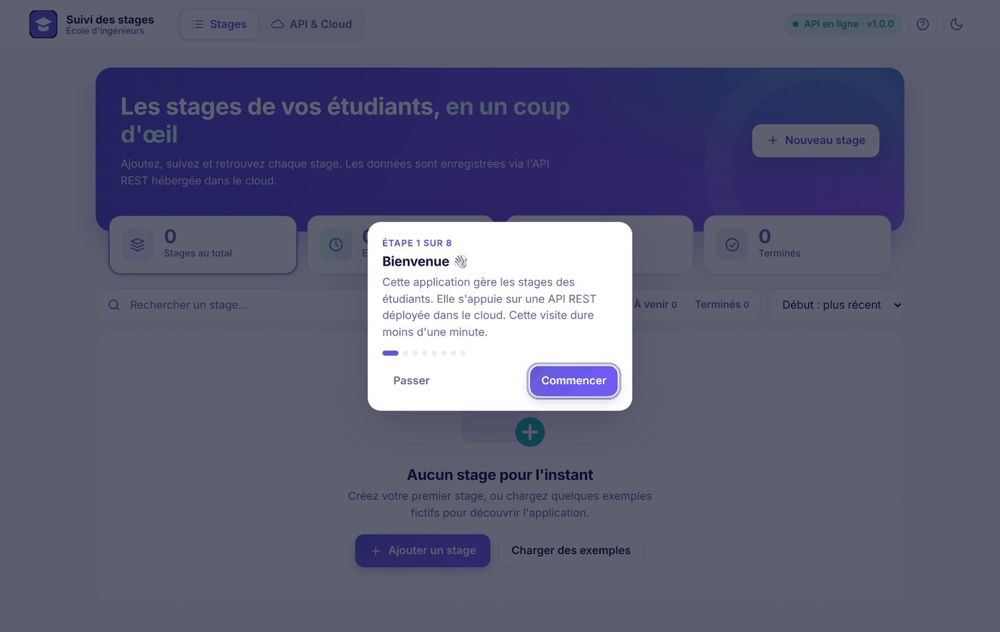 |
| **Alertes « À surveiller »** (04) | 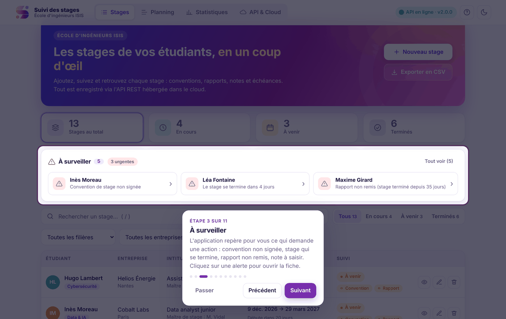 |
| **Formulaire complet** (09, 10) | 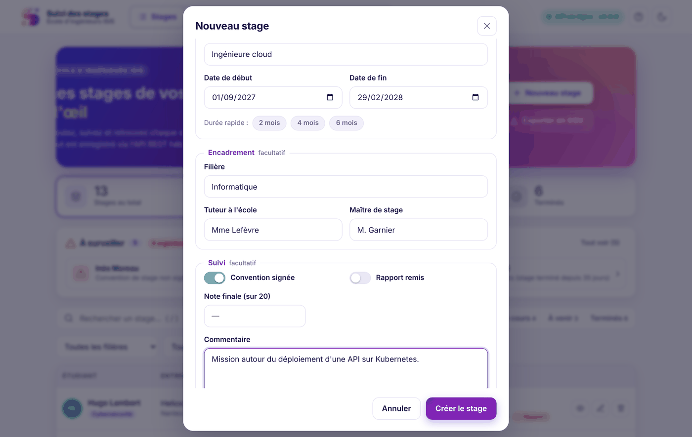 |
| **Fiche mise à jour** (13) | 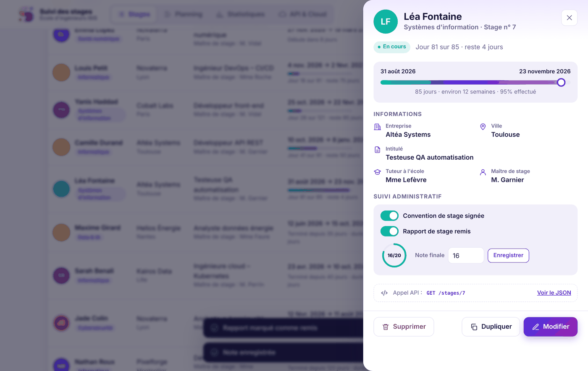 |
| **Filtres** (15) | 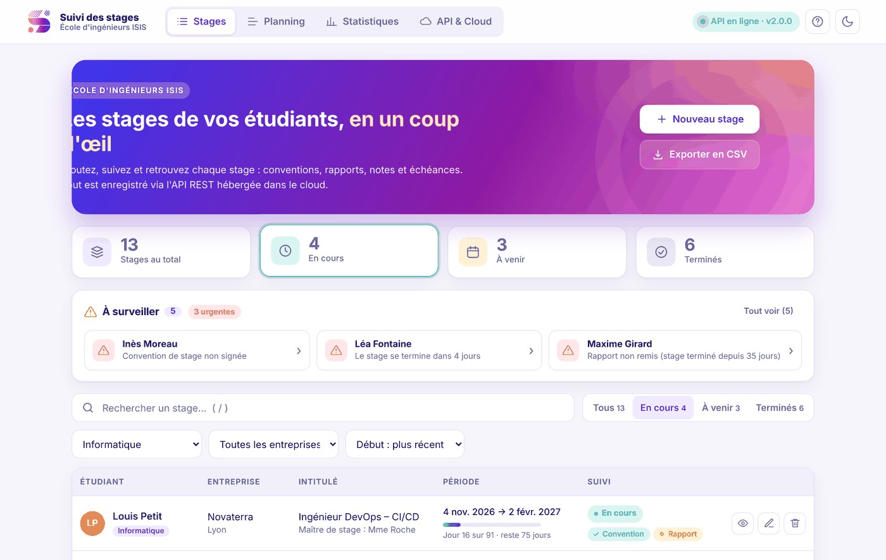 |
| **Planning** (16) | 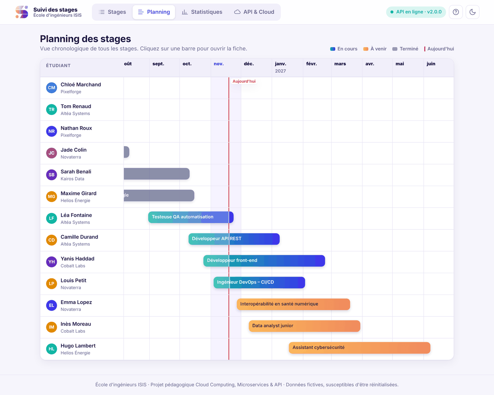 |
| **Statistiques** (17) | 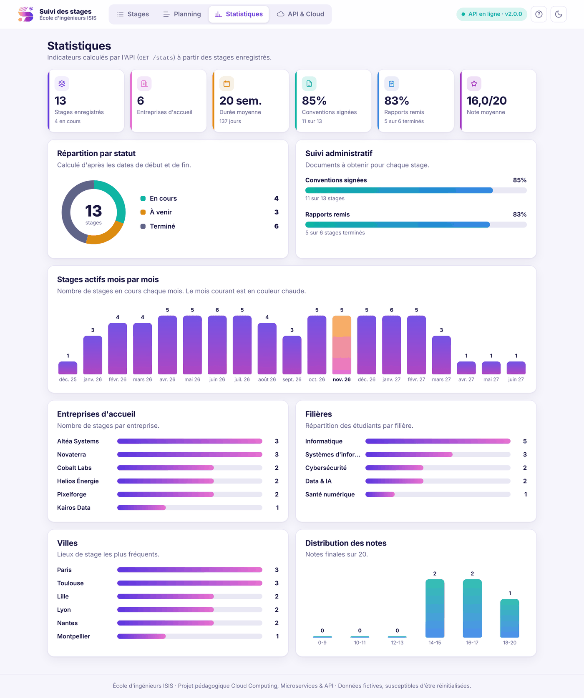 |
| **API & Cloud** (18) | 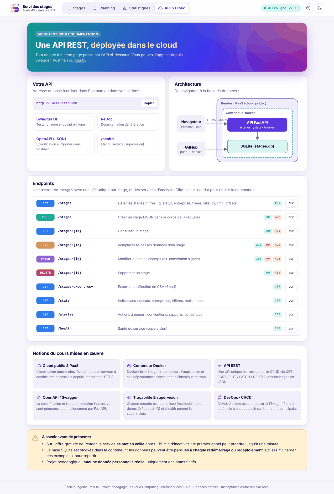 |
| **Thème sombre** (19, 20) | 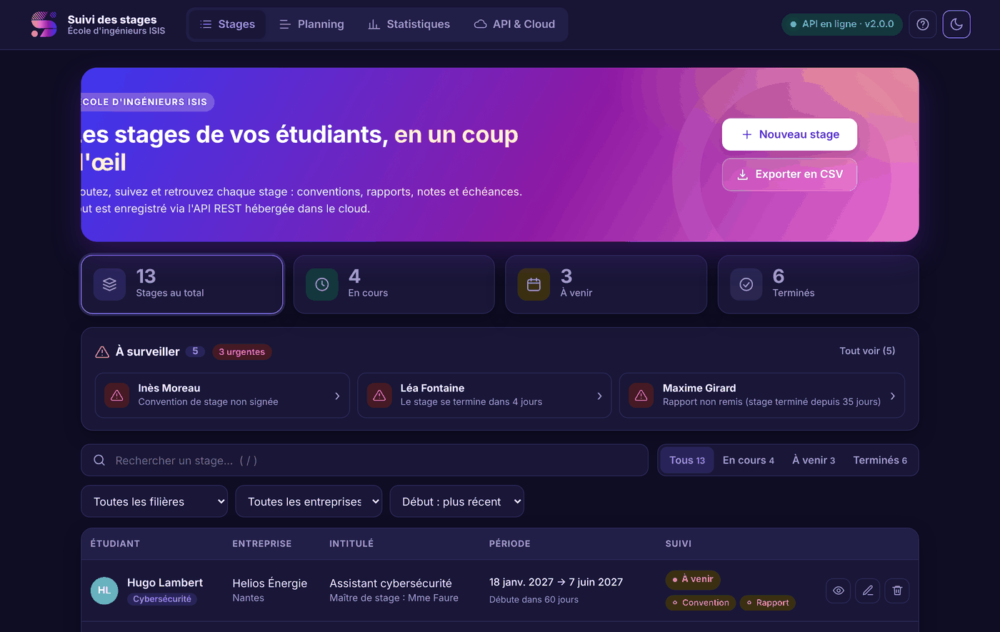 |
| **Mobile** (21 à 23) | 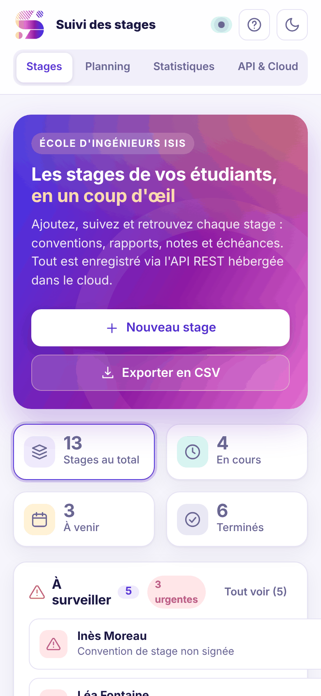 |
| **Swagger** (30 à 41) | 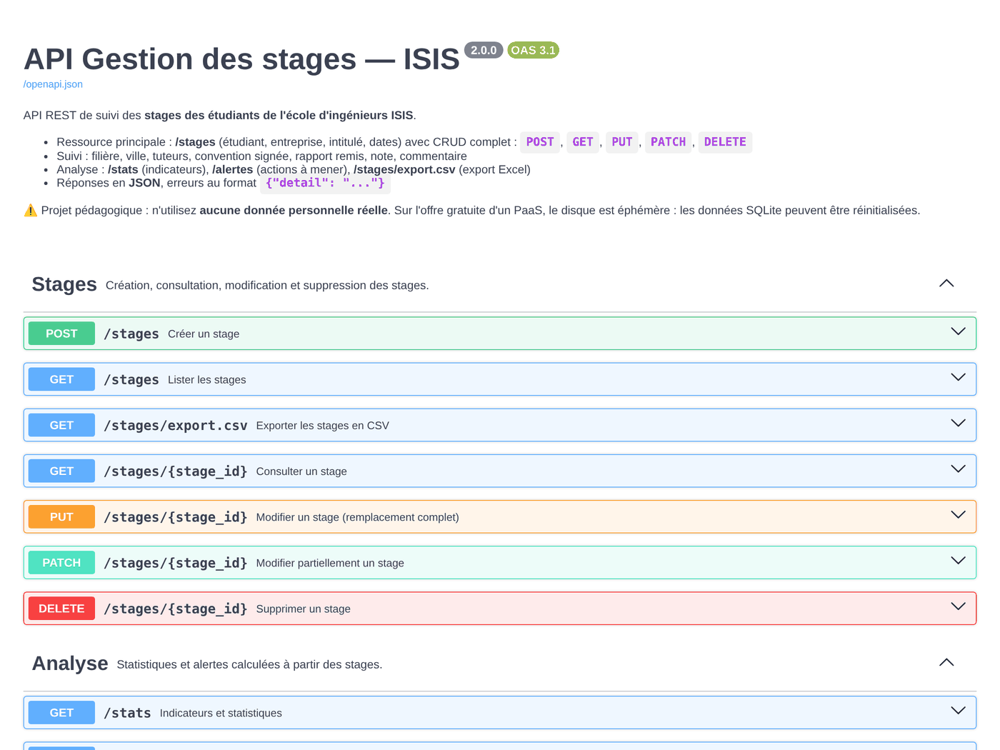 |
| **Docker** (50 à 55) | 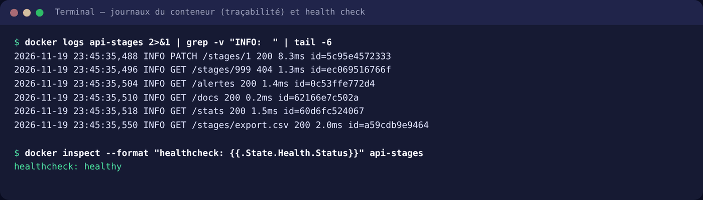 |
